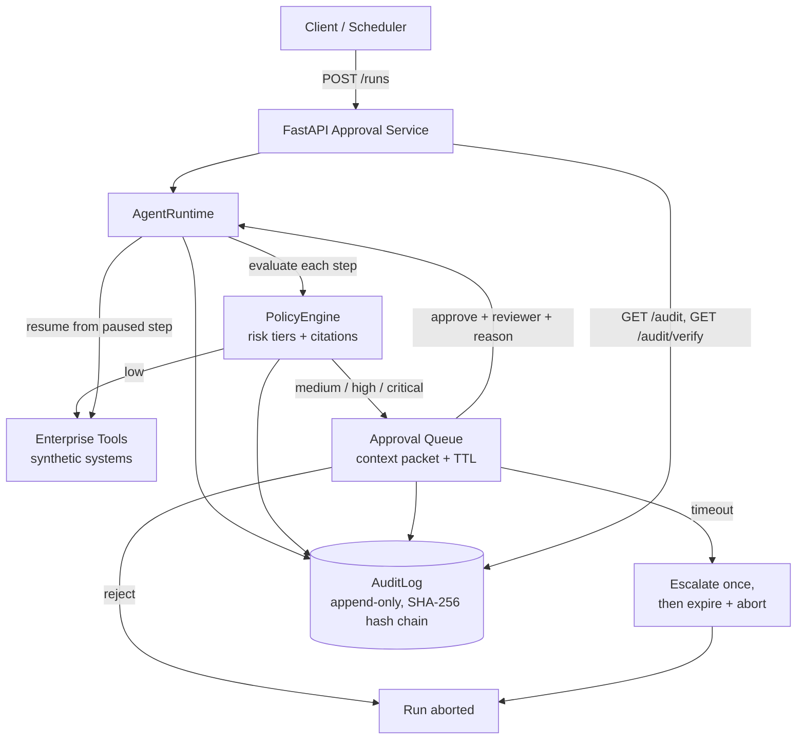

# AI Agent with Human Approval & Audit Logs

A governed agent runtime where **consequential actions need a human
decision before they happen** — and every step, decision, and refusal is
written to a tamper-evident audit log.

## The problem

Autonomous agents are easy to demo and hard to trust in production. An
agent that can issue refunds, edit customer records, or export data will
eventually take an action nobody would have approved: a refund with no
matching failure, a sensitive field changed on a hunch, a bulk delete
nobody saw coming. "The model decided to" is not an accountability model.

This project implements the governance layer enterprises actually ask for:

- **Risk-tiered execution** — routine actions run automatically;
  consequential ones *pause* until a human decides.
- **Decision-grade context** — reviewers don't get "approve? y/n". They
  get what the action is, why the agent wants it, its expected effect,
  its risk tier, and the exact policy rules that gated it.
- **Fail-closed timeouts** — an ignored approval escalates once, then
  expires and aborts the run. Silence is never consent.
- **A tamper-evident record of everything** — policy evaluations,
  approvals, rejections, executions, and aborts land in an append-only,
  hash-chained audit log whose integrity anyone can verify.

## Governance model

| Tier | Meaning | Behavior |
| --- | --- | --- |
| `low` | Routine, reversible, internal | Executes automatically |
| `medium` | Customer-visible or money-adjacent | Pauses for human approval |
| `high` | Sensitive data, large amounts, exports, deletes | Pauses; senior review recommended |
| `critical` | Bulk/irreversible or unknown tools | Pauses; flagged critical in the packet |

Tiers come from a deterministic policy engine (`policy.py`): a per-tool
base tier adjusted by rules with citations — refund amount thresholds
(`POL-FIN-*`), sensitive fields and PII flags (`POL-DATA-*`), external
communications (`POL-COM-*`), and a fail-closed rule for unregistered
tools (`POL-GEN-00`).

## Architecture



Full design notes: [docs/architecture.md](docs/architecture.md).

## Quickstart

```bash
python -m venv .venv && source .venv/bin/activate
pip install -e ".[dev]"

# the three governed flows, in-process:
python -m governed_agent.demo

# or run the approval service:
uvicorn governed_agent.service:app --port 8000
```

Try it over HTTP:

```bash
# a run whose refund step will pause for approval
curl -s -X POST localhost:8000/runs -H 'content-type: application/json' \
  -d @examples/sample_plan.json

# see what is waiting for a human, with full context packets
curl -s "localhost:8000/approvals?status=pending"

# decide (identity + reason are recorded)
curl -s -X POST localhost:8000/approvals/<id>/approve \
  -H 'content-type: application/json' \
  -d '{"reviewer": "sam.reviewer", "reason": "Damage confirmed on the case."}'

# verify the audit chain is intact
curl -s localhost:8000/audit/verify
```

## API

| Method & path | Purpose |
| --- | --- |
| `GET /health` | Liveness |
| `POST /runs` | Start a run from `{goal, steps[]}`; returns run state (may be `paused`) |
| `GET /runs/{id}` | Run status, results, abort reason |
| `GET /approvals?status=pending` | Approval queue with context packets |
| `GET /approvals/{id}` | One approval, incl. decision metadata |
| `POST /approvals/{id}/approve` | `{reviewer, reason}` → resumes the run |
| `POST /approvals/{id}/reject` | `{reviewer, reason}` → aborts the run |
| `POST /approvals/check-timeouts` | Escalate/expire overdue approvals |
| `GET /audit?run_id=&event=` | Query audit entries |
| `GET /audit/verify` | Recompute the hash chain; report first broken entry |

## Testing

```bash
pytest -q
```

The suite covers:

- **Policy tiers** — every threshold boundary, sensitive-field and PII
  escalation, bulk-delete criticality, fail-closed unknown tools.
- **Hash-chain verification** — intact chains verify; edited, rehashed,
  deleted, or reordered entries are detected at the right sequence.
- **Resume-after-approval** — paused runs execute nothing early, resume
  at the exact step, survive two sequential gates; rejections abort with
  zero side effects; timeout → escalation → expiry; escalated approvals
  remain decidable inside the grace window.
- **HTTP service** — queue/decision flows, 404/409 behavior, audit
  query + verify endpoints.

## Limitations

- **In-memory state.** Runs, approvals, and the audit log live in
  process memory; restarting the service loses them. The layers are
  storage-agnostic, but no persistence adapter ships in v1.
- **No authentication.** Reviewer identity is asserted, not verified —
  there is no SSO/RBAC in front of the decision endpoints. Do not expose
  this service beyond a trusted network as-is.
- **Simulated tools and clock-driven escalation.** Tools are in-memory
  stand-ins, and timeout escalation happens when `check_timeouts` is
  called (API/cron), not on a background thread.
- **Hash chain ≠ anchored ledger.** Tampering with an exported log is
  *detectable*, but nothing stops an attacker with write access from
  regenerating a whole chain. Anchor the head hash externally for that
  guarantee (roadmap).

## Roadmap

- Persistence adapters (Postgres) for runs, approvals, and audit entries.
- External anchoring of the audit chain head (e.g., periodic signed
  checkpoints) and JSONL export for SIEM ingestion.
- Reviewer auth via OIDC + role-based rules (HIGH/CRITICAL require a
  senior role; four-eyes rule for CRITICAL).
- Pluggable policy packs (YAML-defined rules) and per-tenant tiers.
- Slack/Teams approval notifications with deep links to the queue.
- An LLM planner front-end that produces plans in the same
  `ActionRequest` format, so planning and governance stay decoupled.

## License

MIT — see [LICENSE](LICENSE).
